# Lotería Doloreña

Proyecto complementario de práctica TDD de Desarrollo Móvil Integral.
Juego de lotería con 16 cartas de la Independencia y Dolores Hidalgo, construido con Flutter y guiado por pruebas (rojo, verde, refactor).

**Alumno:** Aguilar Ortiz Gael Alejandro
**Grupo:** GTID235
**Universidad:** Universidad Tecnológica del Norte de Guanajuato (UTNG)

## Estructura del proyecto

```
lib/
  modelos/carta.dart
  logica/baraja.dart
  logica/tabla.dart
  logica/verificador_patrones.dart
  logica/motor_juego.dart
  main.dart
test/
  baraja_test.dart
  tabla_test.dart
  verificador_patrones_test.dart
  motor_juego_test.dart
```

## Evidencia por ronda

En cada captura se ve primero la ejecución de `flutter test` con la prueba fallando (rojo, línea `-1` o `-2`) y después la ejecución con todas las pruebas pasando (verde).

### Ronda 1: La baraja completa
La baraja se crea con 16 cartas distintas. Rojo (`+0 -1`) y verde (`+2`).

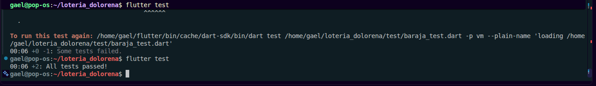

### Ronda 2: Barajar sin perder ni duplicar cartas
`mezclar()` cambia el orden pero conserva las mismas 16 cartas. Rojo (`+0 -1`) y verde (`+3`).

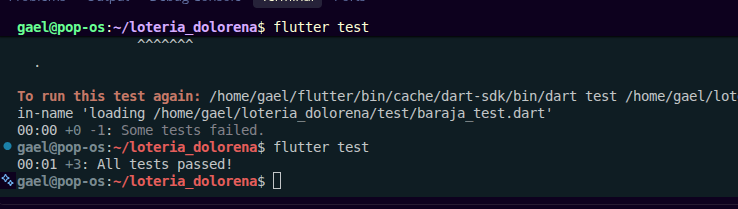

### Ronda 3: Cantar cartas, una por una
`cantarSiguiente()` entrega una carta y la retira del mazo; regresa `null` cuando ya no hay. Rojo (`+0 -1`) y verde (`+5`). En el refactor se cambió `removeAt(0)` por `removeLast()` y las pruebas siguieron en `+5`.

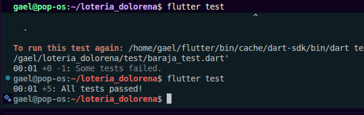

### Ronda 4: La tabla de 4x4
La tabla contiene las 16 cartas sin repetir y nace sin celdas marcadas. Rojo (`+5 -2`) y verde (`+7`).

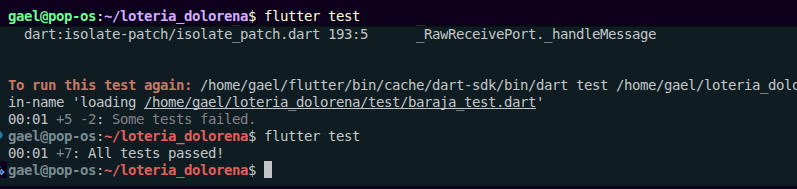

### Ronda 5: Marcar una carta en la tabla
`marcar()` marca la celda de la carta y no hace nada si la carta no está. Rojo (`+5 -2`) y verde (`+9`).

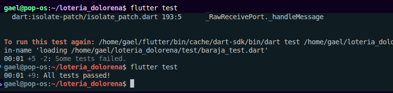

### Ronda 6: Detectar una línea horizontal
`hayLinea()` detecta una fila completa. Rojo (`+9 -1`) y verde (`+11`).

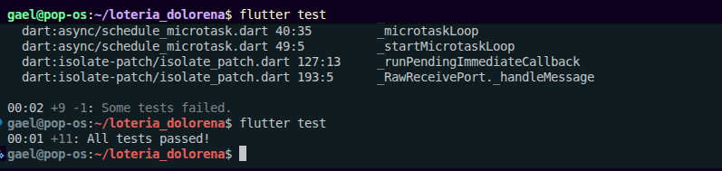

### Ronda 7: Detectar una columna
`hayColumna()` detecta una columna completa. Rojo (`+9 -1`) y verde (`+13`).

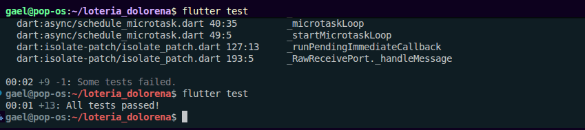

### Ronda 8: Detectar una diagonal
`hayDiagonal()` detecta la diagonal principal y la secundaria. Rojo (`+9 -1`), verde (`+15`) y refactor con el método `hayGanador()` (sigue en `+15`).

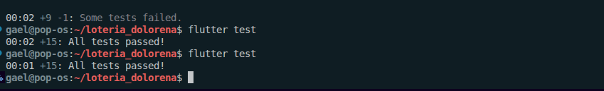

### Ronda 9: Constructores para controlar el orden en las pruebas
Se agregaron `Baraja.desdeCartas` y `Tabla.desdeFilas` para poder probar sin azar. Las 15 pruebas existentes siguen pasando.

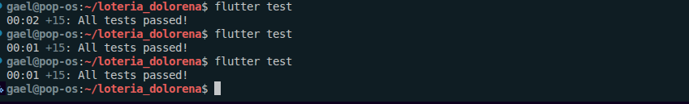

### Ronda 10: El motor de juego
`MotorJuego` orquesta la baraja, la tabla y el verificador. Rojo (`+15 -1`) y verde (`+17`).

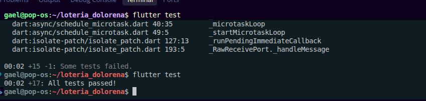

## Resultado final

Las 17 pruebas de lógica pasan (ver la captura de la Ronda 10, `+17: All tests passed!`).

El juego se ejecutó en un celular Android conectado por USB (`flutter devices` lo detecta como `23122PCD1G`):

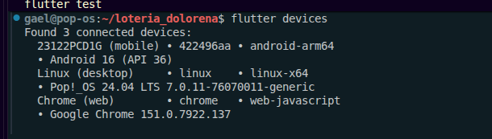

Diálogo de Lotería al completar una línea, columna o diagonal:

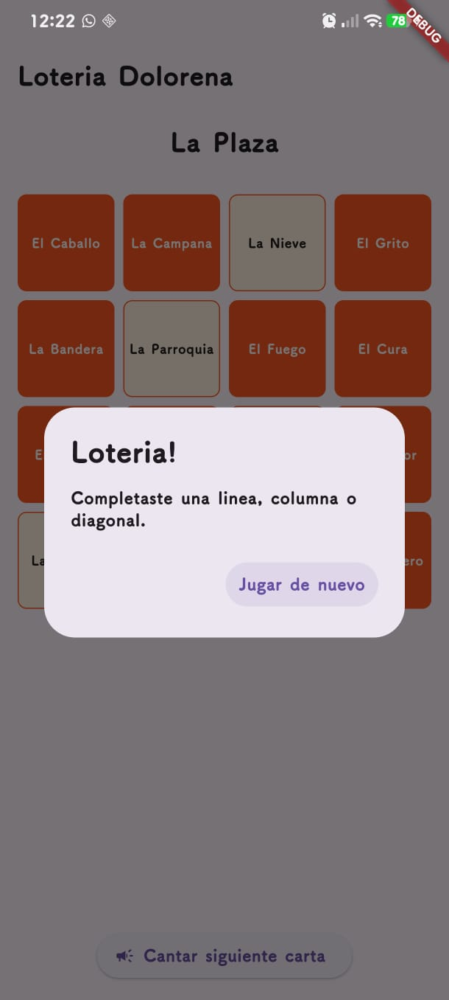

## Cómo ejecutar

```
flutter pub get
flutter test
flutter run
```
